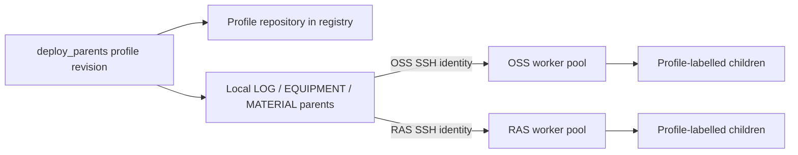

# OSS/RAS parents, SSH workers and registry maintenance

The scripts live in `extras/deployment` and run on the machine that will host the
three persistent parents. They use Python 3, the Docker CLI and an existing local
Docker daemon. SSH to workers runs in a disposable copy of the selected image,
as `appuser`, using the same read-only credentials as the parents.

## Configuration and prerequisites

Create `/etc/dynreact/agents-oss.env` and `/etc/dynreact/agents-ras.env` from the supplied examples.
All three commands (deployment, listing and cleanup) read these same files and
print the selected configuration path on stderr. Legacy `oss.env`/`ras.env` files
are not read. Use Docker env-file syntax: literal `KEY=value`, without `export`, shell expansion
or quotes. Replace the example service and worker addresses. The two profiles have
separate image repositories, Kafka topics, container prefixes, log paths and SSH
identities. `OSS_DOCKER_WORKERS` is used only by OSS; RAS uses `RAS_DOCKER_WORKERS`.
Worker URLs must be `ssh://oss@host[:port]` or `ssh://ras@host[:port]`, respectively.

Create `/etc/dynreact/ssh-oss` and `/etc/dynreact/ssh-ras`. Each directory contains
`id_ed25519` or `id_rsa`, trusted `known_hosts`, and optionally `config`. Verify
server fingerprints before adding host keys. Do not disable host-key checking.
The current image user is `appuser`, UID 1050. Its private key must be readable by
that UID, with private-key mode 0600 and directory mode 0700. The root operator can
install these files and run the deployment script with sudo. The host operator's
personal SSH session is not the container's identity.

Example SSH config for either mounted directory:

```sshconfig
Host *
    BatchMode yes
    IdentitiesOnly yes
    ConnectTimeout 10
    StrictHostKeyChecking yes
```

The remote profile user must run `docker info` without a password or sudo. Docker
must be installed, and registry login must already be configured for that user.
All workers must reach Kafka's advertised broker addresses and the profile's REST,
performance and transport services. Host networking does not span VMs; Docker
bridge names must exist separately on each worker if configured instead of `host`.
The worker log directory defaults to `/home/oss/dynreact-logs` or
`/home/ras/dynreact-logs`; the profile user must be able to create it.

Users in the same system Docker group share daemon privileges. Profile labels and
names prevent accidental cross-profile cleanup, but are not a security boundary.
Use separate rootless daemons or separate VMs if permission isolation is required.

Build/publish an updated OSS image containing `remote_pool.py` and OpenSSH. Rebuild
RAS on that updated base; its Dockerfile also copies the shared common directory.
Older images cannot acquire distributed placement just by setting environment
variables. The deploy script checks that the selected image has SSH and the pool
module before replacing parents.

## Deploy all three parents locally

```sh
sudo env DYNREACT_DRY_RUN=1 ./extras/deployment/deploy_parents.sh oss abc1234
sudo ./extras/deployment/deploy_parents.sh oss abc1234
sudo ./extras/deployment/deploy_parents.sh ras abc1234
```

The second argument selects an **existing registry tag**. It is not a Git checkout
or build command. By default the tag is used literally. Set
`IMAGE_TAG_TEMPLATE=git-{revision}` to map `abc1234` to `git-abc1234`. Existing Jenkins
`build-N` tags can be passed literally too. The script does not assume those tags
encode Git commits, and does not build or push images.

The script pulls the profile image locally and pins its registry digest. It then
checks every worker via SSH, creates its log directory, pulls that same digest,
checks the image ID and assigns the requested tag. All hosts must use the same
CPU architecture. Only after all preloads succeed does it replace the three local
parents (LOG, EQUIPMENT, MATERIAL), using:

- the profile env file plus explicit image/profile/topic/log-path overrides;
- `--restart unless-stopped`, host networking by default, and verbose **1**;
- the local Docker socket for each parent, profile-specific log and SSH mounts;
- `python -m dynreact.shortterm.agents ROLE base -k KAFKA_IP -v 1`.

`-k` is required by the DynReAct CLI. DeepScheduling's `DS_*` variables and module
names do not configure DynReAct. The image is fixed for both parents and replicas
through `DYNREACT_SHORTTERM_IMAGE`; `LOCAL_REGISTRY`, `IMAGE_NAME` and `IMAGE_TAG`
remain populated for compatibility.

Existing parent names must carry matching `dynreact.profile` and
`dynreact.kind=base` labels. Unmanaged containers are not silently replaced.
Deploy with no active auctions. Replacement is sequential, not transactional; a
failure after replacement starts can leave a partial deployment. Inspect and fix
it before launching work. Immediate Docker running-state checks are not an
application health certification.

After deployment, old **tags in that exact repository** are removed locally and
on the workers only when their image is unused by *all* containers, including
stopped containers. No container/image prune or forced image removal is used.
This does not delete registry images or other profile images. Preexisting dangling
untagged images are left alone.

Inspect startup and fleet placement before a large Recommender run:

```sh
docker logs --tail 50 dynreact-oss-material-base
ssh oss@WORKER docker ps --filter label=dynreact.profile=oss
```

Parents stay on the machine running the script. The script does not provision VMs
or automatically place parents on different machines.

## How replica placement works

The existing `DockerManager` uses a remote containers facade when its profile has
workers configured. All three replica roles are distributed; a profile without a
worker list retains local behavior. Each new child goes to the worker with the
fewest active profile containers, rotating equal-load choices. Counts use one
bulk summary call per worker, avoiding per-container inspection for placement.

`DYNREACT_WORKER_LIMIT` is an optional **advisory** active-container ceiling per
worker/profile (0 means unlimited). Independent parents do not share an atomic
reservation, so simultaneous launches can exceed that advisory ceiling. This is
load-aware placement, not a hard admission queue, RAM-aware scheduler or HA system.
A full fleet raises an explicit launch error; it does not silently queue the job.
Do not use the advisory limit as the only protection against host memory exhaustion.
`DYNREACT_REPLICA_MEMORY` and `DYNREACT_REPLICA_CPUS` set per-container limits when
configured. Choose them from measured workloads; too little memory kills agents.

Placement first checks all workers for a matching existing name. A matching running
owned child is reused, preventing duplication after an ambiguous timeout. Stopped
matches require explicit inspection/cleanup. If any worker cannot be queried,
placement fails rather than creating a possible duplicate elsewhere. No automatic
migration or retry on another host is claimed. Keep the fleet fixed during active
auctions. Existing auction error handling is retained.

Listing, targeted cleanup and the existing reaper operate across the configured
fleet through container objects bound to their actual Docker host. An unreachable
worker makes fleet-wide inspection incomplete; it can require later cleanup.
MATERIAL, EQUIPMENT and LOG children use `auto_remove=True`; parents remain
persistent with `restart unless-stopped`. Exiting children disappear from Docker
immediately, including failed children. Their bind-mounted application log files
survive; their exit metadata and Docker stdout logs do not. Keep an external log
collector for stdout retention. The reaper remains relevant for stuck/orphan
running replicas and retained legacy containers. Rebuild both profile images to
activate this behavior; changing an env-file cannot change an existing child's
Docker auto-remove setting.

Replicas receive no SSH credentials and no Docker socket; their log bind mount is
resolved on the selected worker, not on the parent host.



Each invocation configures only its selected profile; arrows illustrate the two
separate deployments, not a parent with access to both sets of credentials.

## List registry tags and creation dates

```sh
sudo ./extras/deployment/list_registry_images.sh oss
sudo ./extras/deployment/list_registry_images.sh ras
```

The listing prints tag, creation timestamp and manifest digest for the selected
`IMAGE_NAME`. It follows Registry V2 pagination and supports Docker schema-2/OCI
manifests and multi-platform indexes. A multi-platform date is the latest child
creation date; an unknown child date makes the index date unknown. The timestamp
is the image's creation time, **not its push time** (Registry V2 does not expose a
standard upload-time field here). Unknown dates are printed as `UNKNOWN`.

`REGISTRY_URL` defaults to `http://LOCAL_REGISTRY_HOST:PORT`; configure HTTPS where
available. Docker login credentials are not automatically reused by this HTTP
client. When needed, pass `DYNREACT_REGISTRY_TOKEN`, or
`DYNREACT_REGISTRY_USER`/`DYNREACT_REGISTRY_PASSWORD`, in the script process
environment. They are not printed. Redirects and cross-origin pagination are
refused to avoid forwarding credentials; registries using redirected blob storage
need a separate, reviewed client adaptation. The initial supported deployment is
the directly reachable private Distribution registry.

## Delete registry manifests older than X days

Preview, with exactly the requested two arguments:

```sh
sudo ./extras/deployment/prune_registry_images.sh oss 30
sudo ./extras/deployment/prune_registry_images.sh ras 60
```

Apply the reviewed candidates:

```sh
sudo env DYNREACT_APPLY=1 ./extras/deployment/prune_registry_images.sh oss 30
```

The default is preview. X is a nonnegative integer; the cutoff uses UTC. A manifest
is eligible only if its creation date is strictly older than that cutoff. All tag
aliases of a digest are considered together. Defaults protect `latest`, `stable`
and `production`; `REGISTRY_PROTECTED_TAGS` can replace that comma-separated list.
Unknown dates and child manifests referenced by any tagged index are retained.
An unsupported/unreadable manifest aborts inventory, so no partial inventory is
used to authorize deletion.

Before **any** deletion, apply mode obtains image IDs from every local and
configured worker container, including stopped containers. Matching manifest config
digests are retained. All workers must be reachable. By default, an existing profile
parent supplies the local SSH-helper image. Alternatively set `REGISTRY_SSH_IMAGE`
to an already available local image containing `appuser` and OpenSSH. If no helper
or profile parent exists locally, the host OpenSSH client uses the private key and
known_hosts from the profile SSH directory. The invoking user must be able to read
those files. Parents need not run on the registry host. With no eligible candidates,
the script exits successfully before Docker/SSH checks. Nanosecond timestamps are
normalized to microseconds for compatibility with older Python ISO parsers, with
the OCI creation label used when the primary timestamp cannot be parsed. Maintain an
accurate worker list: the script cannot discover deployments on unlisted machines.

Aliases are rechecked immediately before deletion. This does not lock the registry
against concurrent pushes, retagging or new deployments: run cleanup during a
maintenance window with those writers paused. Deletion removes the manifest by
digest, potentially removing all its tag aliases; it is not just tag removal.
The registry must enable manifest deletion (Distribution setting
`REGISTRY_STORAGE_DELETE_ENABLED=true`). A 405/unsupported operation needs registry
administration; the script does not change the registry configuration.

No automatic registry garbage collection is run. Manifest deletion alone does not
promise immediate disk reclamation. Plan registry garbage collection separately
according to its storage backend and maintenance policy. See the primary
[Distribution Registry V2 specification](https://distribution.github.io/distribution/spec/api/).

A custom configuration directory can be selected with `DYNREACT_CONFIG_DIR`.
None of these scripts runs merely by being installed. Unit tests use mocked
Docker/SSH/registry operations and do not attest live deployment readiness.

## Jenkins Kafka connectivity failures

Jenkins obtains `KAFKA_IP` from its credential binding, not from the deployment
host's `agents-oss.env` or `agents-ras.env`. Updating those files does not update
the CI broker. Keep masking enabled; do not print credentials to diagnose routing.

The OSS Jenkinsfile runs `Kafka Connectivity Preflight` after image verification
and before replacing parents or purging verification topics. It mounts
`extras/kafka_preflight.py` into the same runtime image, with host networking and
the existing credential passed through `-e KAFKA_IP` without logging its value.
The script checks endpoint syntax, DNS, bootstrap TCP, read-only Kafka metadata
and every advertised broker. It does not create/delete topics or agents.

`HOST_UNREACHABLE`/`NETWORK_UNREACHABLE` indicate an OS network error; inspect the
broker address configured in Jenkins, reachability, firewall and service health
from the actual Jenkins agent host. `CONNECTION_REFUSED` commonly indicates an
unavailable listener or active rejection; a timeout can also involve routing or
filtering. TCP success followed by `METADATA_FAILED` requires checking Kafka
health/protocol/authentication. `METADATA_OK` followed by advertised-broker failure
requires reviewing `advertised.listeners` and network access to those addresses.
A previously working pipeline can fail after a broker, network policy, credential
or Jenkins agent changes; the console alone cannot distinguish those causes.
